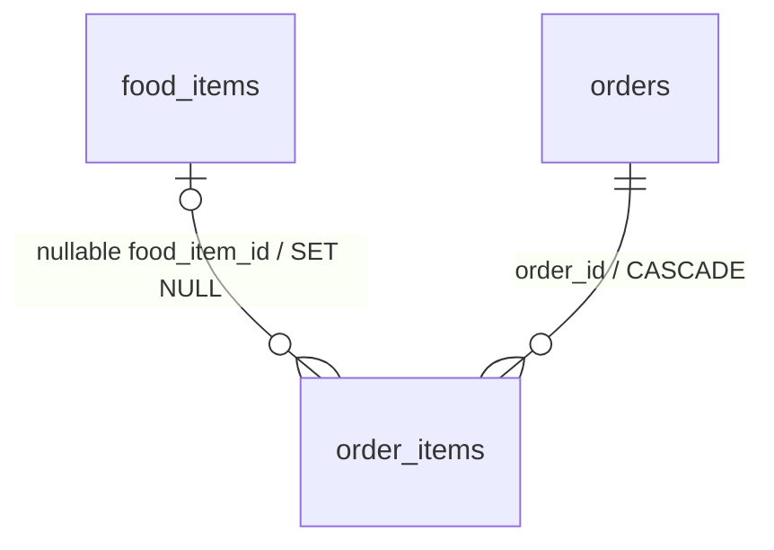

# TideBites PR 1 共用資料庫串接規格（候選版，待 A/B 共同確認）

本文件依 `origin/main` 的 `75cbb4c`、`index.html` 與 `js/script.js` 建立。
本 PR 只有資料庫、共用連線、CLI 工具與測試；前端、訂單提交、管理員登入及權限控制均未實作。
**這是已可測試的候選合約，不代表 B 已同意。合併前須由 A/B 確認下方清單。**

## 共用環境與介面

- MySQL 8.4 LTS；本次實測 8.4.9。PHP 8.4；本次實測 8.4.28，使用 PDO/pdo_mysql。
- 正式本機資料庫預設 `tidebites`，各組員各自安裝，**不共用遠端伺服器或個人密碼**。
- 結構及十道原始餐點的唯一初始化來源：`database/tidebites.sql`。
- 設定與初始化：見 [database-setup.md](database-setup.md)。CLI 的 `Install` 拒絕接管既有資料庫、同名帳號及設定檔。
- 共用入口：`require_once .../config/database.php`，呼叫 `tidebites_pdo(): PDO`；同一 PHP 請求重用一個連線。
- `tidebites_connect(array $config): PDO` 提供明確設定的同一連線實作，主要供工具及隔離測試使用。
- PDO 使用 utf8mb4、Exception、原生 prepared statements，停用多重 SQL statements；預設回傳關聯陣列。
- 真實設定預設放於**專案的上一層** `tidebites-local/database.php`，或以 `TIDEBITES_CONFIG` 指向外部設定檔。程式拒絕專案內、或 HTTP document root 內的設定檔。
- 網站連線拒用 `root`。連線失敗只提供一般錯誤，不附帶底層例外或憑證；B 的 HTTP 端點應捕捉例外並回傳一般 503 訊息。
- DATETIME 一律存 **UTC**；共用連線及 SQL 匯入設定 `+00:00`，顯示時再轉 `Asia/Taipei`。

## 資料表完整結構

所有表為 InnoDB、預設 `utf8mb4_0900_ai_ci`。以下沒有註明 NULL 的欄位均為 NOT NULL。
所有 `id` 均為 `INT UNSIGNED AUTO_INCREMENT PRIMARY KEY`；識別碼不重用。

### food_items

| 欄位 | 型態／預設 | 合約 |
| --- | --- | --- |
| id | INT UNSIGNED、自增 PK | 原有 ID 1–10 保留，新餐點用自增 ID |
| name | VARCHAR(150) | 原卡片名稱；不可空白 |
| description | TEXT | 原 `.card-desc`，卡片及詳情共用；不可空白 |
| price | DECIMAL(10,2) | 單位為新臺幣元；非負，PDO 讀取為十進位字串 |
| category | VARCHAR(20) | CHECK 限制精確小寫 `meals`、`desserts` |
| image_path | VARCHAR(500) | 相對專案根目錄的路徑，不含網域、開頭斜線或個人絕對路徑；不可空白 |
| image_alt | VARCHAR(500) | 保留原圖片 alt；管理員可編輯 |
| sort_order | SMALLINT UNSIGNED，預設 0 | 目前 1–10；同序時以 id 排序 |
| is_active | TINYINT UNSIGNED，預設 1 | CHECK 只允許 0/1；0 表示不在可訂購菜單顯示 |
| created_at | DATETIME，CURRENT_TIMESTAMP | UTC 建立時間 |
| updated_at | DATETIME，CURRENT_TIMESTAMP，自動更新 | UTC 最後更新時間 |

索引：`idx_food_menu (is_active, category, sort_order, id)`。
原網站沒有另一份長描述、配料標籤、餐點多圖或餐點特色欄位；頁腳的 14 個 tags 屬網站文案，不是每道餐點資料，因此不額外建表。

### admins

| 欄位 | 型態／預設 | 合約 |
| --- | --- | --- |
| id | INT UNSIGNED、自增 PK | 管理員識別碼 |
| username | VARCHAR(100) | UNIQUE `uq_admin_username`，不可空白；資料庫定序不區分大小寫／重音 |
| password_hash | VARCHAR(255) | `password_hash(..., PASSWORD_DEFAULT)` 的結果，CHECK 長度至少 60 |
| created_at | DATETIME，CURRENT_TIMESTAMP | UTC |

SQL **不附預設管理員或預設密碼**。CLI 初始化限制 username 為 3–100 個 ASCII 英數字與 `._-`，密碼 12–72 bytes；同名建立會失敗，不覆蓋雜湊。
PR 2 才實作 `password_verify()`、session、登入／登出、路由授權、CSRF 與管理介面；本 PR 的雜湊測試不是登入功能。

### orders

| 欄位 | 型態／預設 | 合約 |
| --- | --- | --- |
| id | INT UNSIGNED、自增 PK | 訂單識別碼；沒有 customer_id |
| customer_name | VARCHAR(100) NULL | 候選欄位；原網站尚無此輸入，是否必填待 B 確認 |
| phone | VARCHAR(32) NULL | 字串保留 `+` 與前導零；是否必填、格式待 B 確認 |
| delivery_location | VARCHAR(255) | 必填、不可空白；對應原 pickup-location |
| notes | VARCHAR(500) NULL | 選填，對應原 cart-note 的 maxlength=500 |
| subtotal | DECIMAL(10,2) | 必填、非負、原價小計快照 |
| discount_amount | DECIMAL(10,2) | 必填、0 ≤ 折扣 ≤ 小計 |
| total_amount | DECIMAL(10,2) | 必填、CHECK 等於 subtotal - discount_amount |
| created_at | DATETIME，CURRENT_TIMESTAMP | UTC |

索引：`idx_orders_created (created_at, id)`。沒有會員、付款、地址簿、配送追蹤或狀態表。
姓名與電話允許 NULL，確保既有無會員流程可表達；**這不代表最終外送資料已足夠**。

### order_items

| 欄位 | 型態 | 合約 |
| --- | --- | --- |
| id | INT UNSIGNED、自增 PK | 明細識別碼 |
| order_id | INT UNSIGNED | FK → orders.id，ON DELETE CASCADE |
| food_item_id | INT UNSIGNED NULL | FK → food_items.id，ON DELETE SET NULL |
| food_name | VARCHAR(150) | 訂購當時的名稱快照，不可空白 |
| unit_price | DECIMAL(10,2) | 訂購當時的單價快照、非負 |
| quantity | SMALLINT UNSIGNED | CHECK 1–99，沿用原購物車限制 |

索引：`idx_order_items_order (order_id)`、`idx_order_items_food (food_item_id)`。
菜單改名／改價不更新明細快照；刪除餐點只讓 `food_item_id=NULL`，訂單與明細仍存在。
只有明確刪除整張訂單時才連帶刪除明細，日常 app 帳號沒有訂單 DELETE 權限。



## Phase I 資料對應

| id／原 data-id | 分類 | 名稱 | NT$ | sort_order | image_path（前綴皆為 assets/images/） |
| --- | --- | --- | --- | --- | --- |
| 1 | meals | Thai Basil Pork Rice | 129.00 | 1 | thai-basil-pork-rice.jpg |
| 2 | meals | Chicken Oyakodon Bowl | 139.00 | 2 | chicken-oyakodon-bowl.jpg |
| 3 | meals | Taiwanese Fish Ball Noodle Soup | 139.00 | 3 | taiwanese-fish-ball-noodle-soup.jpg |
| 4 | meals | Roasted Chicken Set Meal | 169.00 | 4 | roasted-chicken-set-meal.jpg |
| 5 | meals | Tomato Udon Soup | 159.00 | 5 | tomato-udon-soup.jpg |
| 6 | meals | Beef and Egg Noodles | 179.00 | 6 | beef-and-egg-noodles.jpg |
| 7 | meals | Chilled Pork Noodle Bowl | 149.00 | 7 | chilled-pork-noodle-bowl.jpg |
| 8 | desserts | Watermelon Snow Ice | 99.00 | 8 | watermelon-snow-ice.jpg |
| 9 | desserts | Mango Snow Ice | 109.00 | 9 | mango-snow-ice.jpg |
| 10 | desserts | Peanut Tang Yuan | 79.00 | 10 | peanut-rice-dumplings.jpg |

10 道餐點、7 meals／3 desserts，仍缺 C 提供的 10 道正式餐點才能滿足教授至少 20 道的要求。
名稱、完整描述、alt、價格、圖片及排序直接取自 HTML，未改寫。每道目前只有一張餐點圖，符合每道至少一張的資料結構需求。

原 JS 的 id 是字串，`tidebites_demo_cart_v1` 的儲存格式為 `{ "1": 2 }`。
資料庫 id 是整數；B 建立 `Map` 或回復 localStorage 時應以 `String(row.id)` 正規化，保留既有 key。
先前購物車中的餐點若已刪除或下架，B 需提示使用者並重新驗證；伺服器不能信任客戶端名稱、價格或折扣。

圖片例：`assets/images/thai-basil-pork-rice.jpg`。從根入口 `index.html` 使用該值；位於子路徑的頁面應以專案 base URL 解析，例如 `new URL(row.image_path, appBaseUrl)`，不要相對 API URL 解析，也不要去掉原有路徑或搬檔。
PR 2 的新上傳圖片仍應儲存專案相對路徑，驗證 MIME／路徑；上傳功能及清理被引用圖片的政策留待 PR 2。

## 查詢範例（不是已實作的 API）

例如未來 `api/menu.php` 可引用：

```php
require_once dirname(__DIR__) . '/config/database.php';
try {
    $pdo = tidebites_pdo();
    $query = $pdo->prepare(
        'SELECT id,name,description,price,category,image_path,image_alt,sort_order
         FROM food_items WHERE is_active=1 AND category=? ORDER BY sort_order,id'
    );
    $query->execute(['meals']); // 先驗證分類；ALL 則省略 category 條件
    $items = $query->fetchAll();
} catch (RuntimeException | PDOException $error) {
    http_response_code(503);
    // 回應一般錯誤，不能 echo $error、堆疊或資料庫設定。
}
```

單一詳情：`SELECT id,name,description,price,category,image_path,image_alt FROM food_items WHERE id=? AND is_active=1`，查不到時由 B 回 404。
分類固定由 `meals → Meals`、`desserts → Desserts` 對應標籤；整份菜單使用 `ORDER BY sort_order,id`。
管理員新增／修改／下架／刪除資料後，B 的下次資料庫查詢即取得新狀態，不另維護 JS 菜單副本。
本 PR 保留靜態 HTML，B 後續負責替換讀取方式；禁止將目前靜態首頁誤認為已串接 SQL。

## 訂單交易與折扣交接

原流程只收備註與三個選項：`Campus Main Gate`、`Student Center`、`Library Entrance`。
原程式：小計為價格 × 數量加總；Campus Discount 自動適用全部餐點；`Math.round(subtotal * 0.1)`，總額為小計減折扣，整數 NT$。
SQL 的 DECIMAL(10,2) 可準確存放金額，但**沒有**實作價格計算或強制 10% 折扣。
候選政策是先保留整元菜單與既有取整規則。若未來允許角／分，必須先確認折扣取整單位，不能直接沿用浮點運算。

B 的訂單提交應在一個資料庫交易內：驗證可訂購餐點與數量、從資料庫讀取並鎖定所需餐點、用十進位／整數最小貨幣單位重算價格、寫 orders、寫 order_items 快照、全成功才 commit；任何失敗 rollback。
DB CHECK 只保證單列金額／數量約束，無法保證訂單 subtotal 等於所有明細總和；跨列總額一致性與重複提交防護由 B 負責。
本 PR 測試僅使用固定測試金額驗證表結構及交易，沒有提供訂單處理程式。

## 專用 MySQL 帳號權限

`tidebites_app@localhost` 預設使用 MySQL 8.4 的預設驗證機制；不啟用舊驗證外掛。

| 表 | 權限 | 用途 |
| --- | --- | --- |
| food_items | SELECT, INSERT, UPDATE, DELETE | 共用菜單查詢與後續 A 餐點管理 |
| admins | SELECT, INSERT | 後續登入驗證與 CLI 新增管理員 |
| orders | SELECT, INSERT | B 建立與讀取訂單 |
| order_items | SELECT, INSERT | B 建立與讀取明細 |

不授予 CREATE／ALTER／DROP、GRANT OPTION、全域帳號管理或其他資料庫權限。
資料庫帳號不是網頁管理員帳號；SQL 權限不能代替 PR 2 的 HTTP 存取權限控制。
PR 2 若需要更改管理員密碼、訂單狀態等權限，先與 A/B 協調；不預先放寬。

## 多人協作與合併前確認

A 維護 SQL、共用 PDO 與資料結構；B 維護顧客端查詢與訂單寫入；各自電腦使用同一合約及自己的帳密。
欄位變更先由 A/B 確認，不各自建立不相容 schema。此 SQL 是 bootstrap，不會自動遷移既有表；後續 schema 變更需另外提供明確遷移程序。

- [ ] B 確認姓名／電話是否必填、長度與驗證，地點選項或自由輸入的政策。
- [ ] B 確認金額維持整元、10% 折扣的取整規則、後端總額驗證與鎖定策略。
- [ ] B 確認 id 字串轉換、舊購物車遷移、`is_active`、分類與排序。
- [ ] A/B 確認實體刪除餐點與歷史明細 SET NULL、UTC 時間、最小帳號權限。
- [ ] C 提供剩餘 10 道正式餐點、圖片、描述及資料權利確認；不要為湊數製造內容。

### 可直接轉交 B 的摘要

> PR 1 候選版使用 tidebites，四表為 food_items / admins / orders / order_items。先依 database-setup.md 執行 Install，各自建立本機 DB 與外部設定；PHP require config/database.php 後呼叫 tidebites_pdo()。菜單查 is_active=1，ORDER BY sort_order,id；原 ID 1–10 保留，JS 請轉 String(id)，圖片路徑相對專案根。訂單沒有 customer_id，姓名／電話暫允許 NULL，地點必填、備註最多 500 字；金額保存 subtotal / discount_amount / total_amount。明細保存 food_name / unit_price / quantity，餐點刪除後 food_item_id=NULL，快照保留。請先共同確認上方待辦，PR 1 合併 main 後再開始動態菜單及訂單後端；本 PR 尚未改前端。
